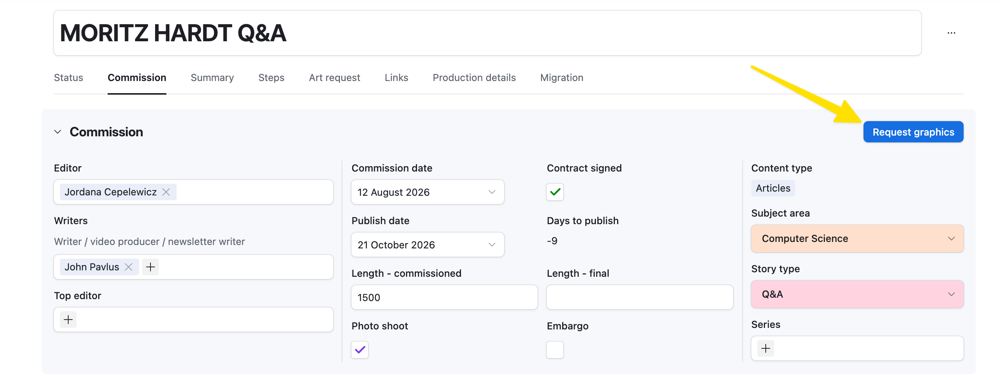

# Graphics and infographics

A piece that needs an infographic is one tick away from the right people knowing.

## Tick Graphics needed

Open the piece and click the blue **Request graphics** button. Two things happen at once. The *Commission infographic* step is added to the piece, owned by the piece's **Graphics designer** (Mark Belan when the field is blank) and dated six weeks before publication. And the art editor and the graphics designer each get a Slack message naming the piece, its editor and its publish date, with a link.

## Or ask for it on the art request

Adding an item of type **Graphic or figure** to the piece's [art request](request-art.md) requests graphics for you, with the same result.

## A different designer

Name the person in the piece's **Graphics designer** field before requesting.
