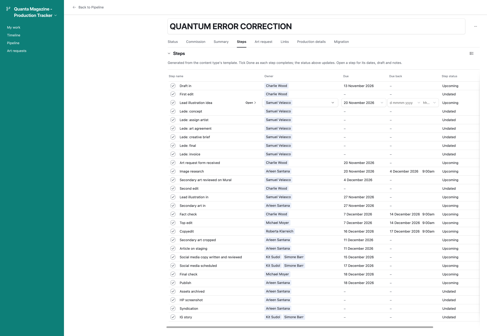

# Schedule a piece

The publish date is the one date that matters. Set it, and the tracker does the rest.

## Set the publish date

1. Open the piece from [Pipeline](https://airtable.com/appFlJWmSk0RDIf1U/pbdMlP776N9XQeREM/pagTU2JvGpMKJK4jc){target=_blank} or [Timeline](https://airtable.com/appFlJWmSk0RDIf1U/pbdMlP776N9XQeREM/pag2Lck56OEnw9CxY){target=_blank}.
2. Fill in **Publish date**.
3. Wait a few seconds. The piece's steps appear below, each with its owner and date, and the piece shows *Commissioned*.

Behind the scenes the tracker reads the piece's content type, works out every step needed, counts each one back from the publish date, and assigns each to the right person. Everyone who receives steps gets a Slack message listing them. The piece's **Commission date** is stamped with today.

!!! example
    An article set to publish on Monday 14 December gets *Fact check* and *Top edit* due Tuesday 1 December, back the following Tuesday; *Copyedit* due Thursday 10 December, back Friday; *Final check* and *Publish* on the Monday; social and archive steps after. About thirty steps in all.

## Change the date

Just change it. Every step not yet done moves with the new date. Steps already checked off keep the dates they were done on. Nobody is told about a re-dated step — they see the new date on their list — but if a step moves to a different person, that person is told.

## The writer's deadline

If you set **Draft due**, the *Draft in* step takes that exact date instead of the standard offset. Set it before or after the publish date; either way it is used as entered.

## Two things to know

Clearing the publish date does **not** delete the steps. They lose their dates and stay on the piece, showing *Undated*. If a scheduled piece is going away for a while, use [On hold](park-or-kill-a-piece.md) instead, and leave the date in place.
